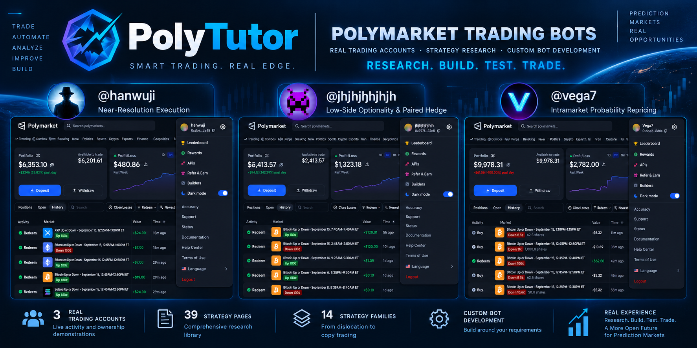
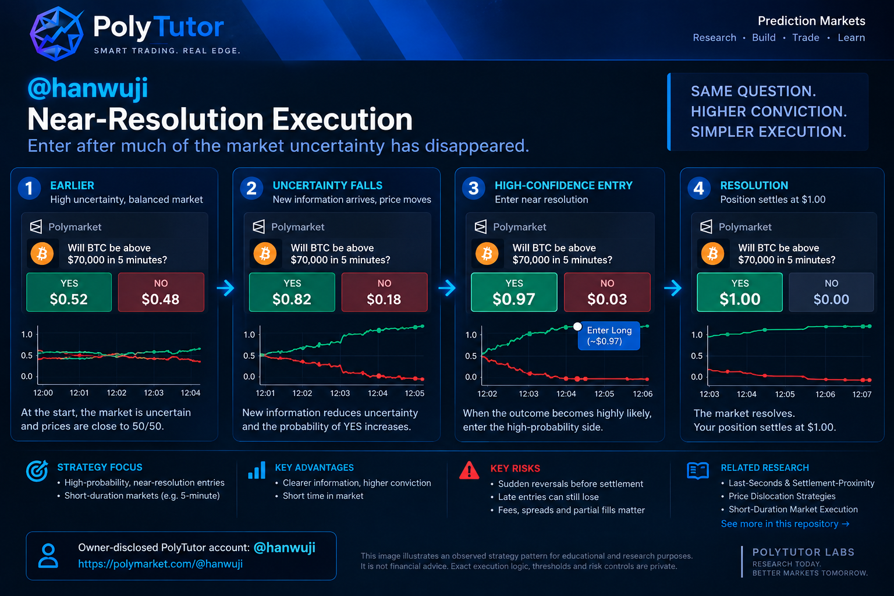
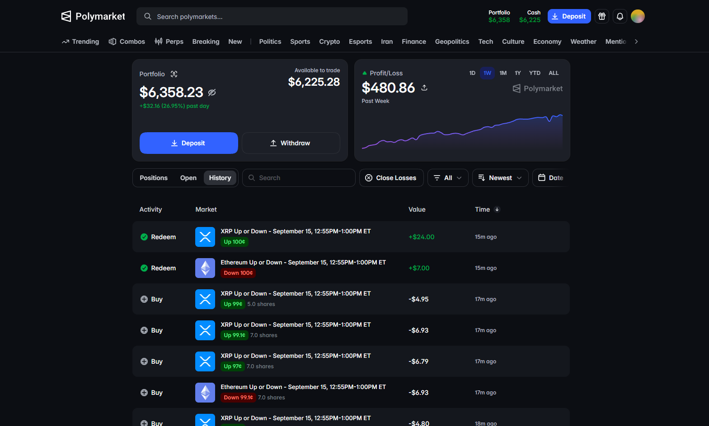
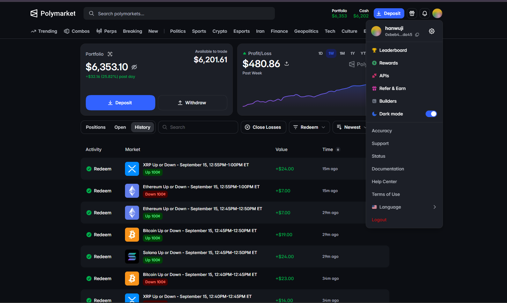
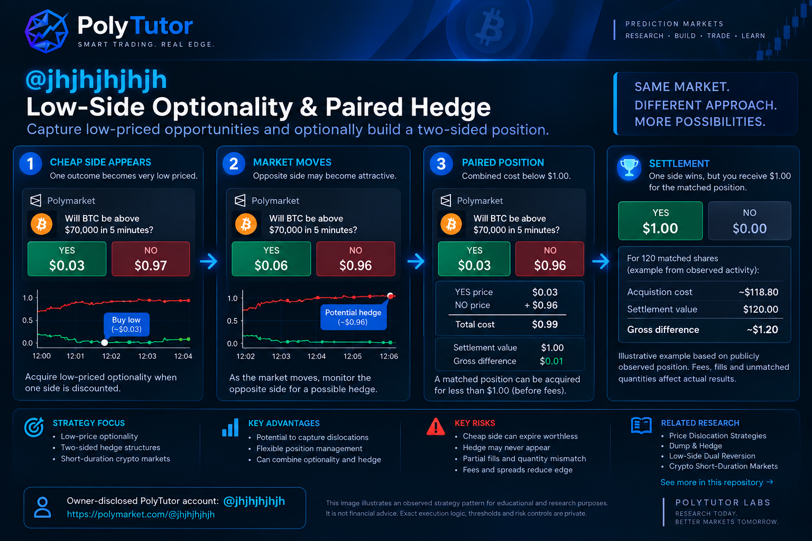
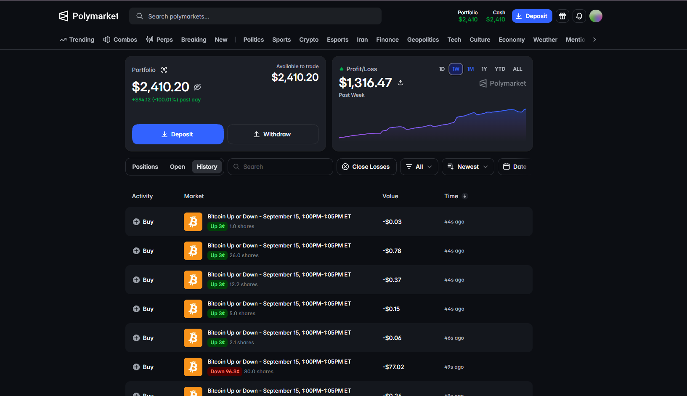
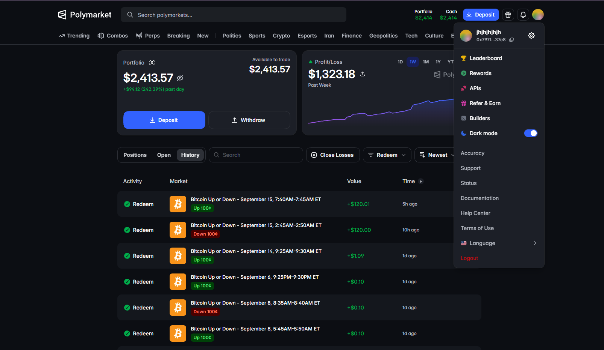
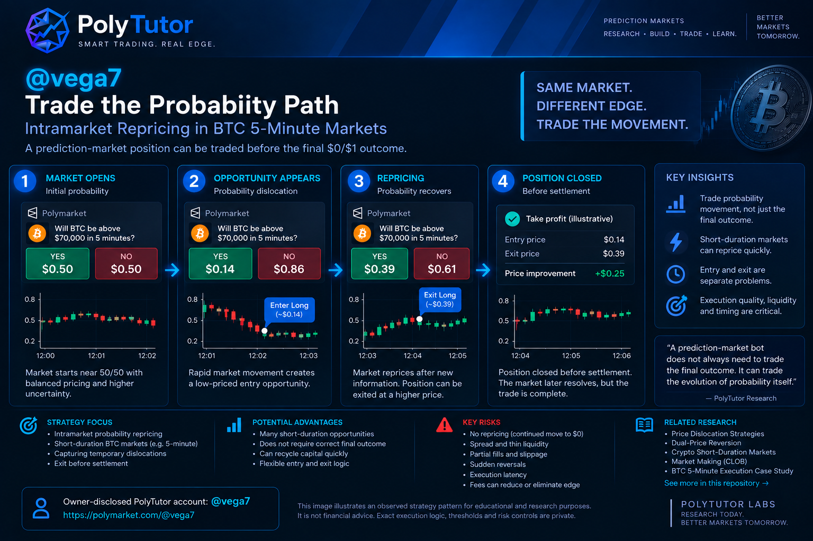
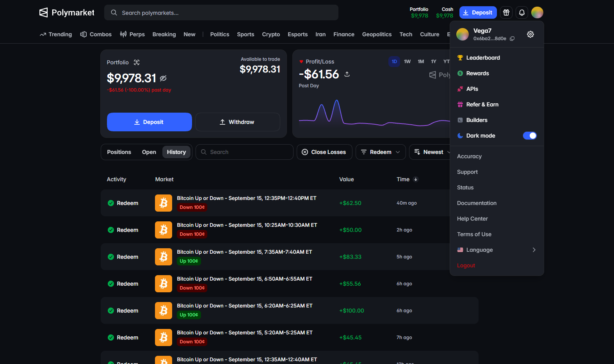
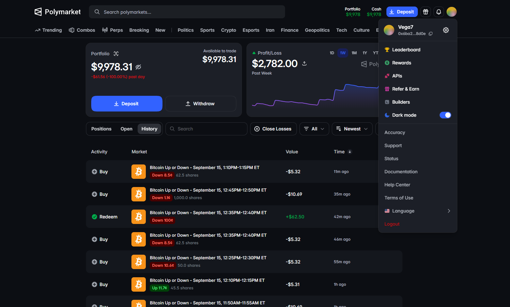

# PolyTutor — Polymarket 交易机器人

[English](./README.md) · **中文**

| 微信 | Telegram | WhatsApp |
| :---: | :---: | :---: |
|  | <a href="https://t.me/polytutor"></a> | <a href="https://wa.me/13512252284"></a> |

### 真实交易账户 · 策略研究 · 定制机器人开发

**研究。构建。测试。交易。**

<p align="center">
  
</p>

我为 Polymarket 构建并运行自动化交易系统。

我已开发并持续改进多套交易机器人，覆盖短周期加密市场、价格错位、对冲、概率重定价、跟单、做市以及其他预测市场策略。

其中一些系统和交易实验产生过历史上的盈利结果。

我可以按你的策略定制 Polymarket 交易系统，把现有的手工流程自动化，改进现有机器人，或协助策略研究、执行与风控架构。

也可以通过电话或视频通话交流。如果你对某个市场、某套策略、或想做的机器人有问题，我们可以一起把问题讲清楚，并分享交易策略与机器人搭建的思路。

如果你想在合作前先评估我的经验，下面直接展示账户、交易活动、所有权演示和策略图示。

**历史结果不保证未来表现。**

[申请定制机器人](https://github.com/polytutor-labs-handbook/polymarket-trading-bots/issues/new?template=bot-request.yml) · [联系 PolyTutor](./docs/contact.md)

---

# 真实 Polymarket 交易账户

这些是 PolyTutor 所有者控制、并用于真实交易与策略研究的 Polymarket 账户。

每个账户在本页直接展示：策略图、公开资料页截图、交易历史截图、账户控制演示。

**所有权由 PolyTutor 自行演示。** 材料反映拍摄当时的控制权与公开活动，不是独立审计。

---

## @hanwuji — 临近结算执行

公开账户：[https://polymarket.com/@hanwuji?tab=activity](https://polymarket.com/@hanwuji?tab=activity)

<p align="center">
  
</p>

### 公开资料页

<p align="center">
  
</p>

### 交易历史

<p align="center">
  
</p>

### 所有权演示

https://github.com/user-attachments/assets/0c447a1e-529c-4f73-a633-14fd1f489905

<video src="./assets/trading-evidence/hanwuji/ownership-demo.mp4" controls width="100%">
  <a href="./assets/trading-evidence/hanwuji/ownership-demo.mp4">
    
  </a>
</video>

[打开完整所有权录像](./assets/trading-evidence/hanwuji/ownership-demo.mp4)

### 策略

**临近结算执行（Near-Resolution Execution）**

研究模式：

- 短周期市场
- 市场过程中不确定性下降
- 结果变得高度可能
- 临近结算入场
- 捕捉剩余结算价差
- 管理偶发的临近反转

不公开具体私有阈值。完整分析：[hanwuji-near-resolution.md](./case-studies/trading-accounts/hanwuji-near-resolution.md)

---

## @jhjhjhjhjh — 低价侧期权性与配对对冲

公开账户：[https://polymarket.com/@jhjhjhjhjh?tab=activity](https://polymarket.com/@jhjhjhjhjh?tab=activity)

<p align="center">
  
</p>

### 公开资料页

<p align="center">
  
</p>

### 交易历史

<p align="center">
  
</p>

### 所有权演示

https://github.com/user-attachments/assets/6bf790a2-8dc5-4b74-bd83-9981ac8e155d

<video src="./assets/trading-evidence/jhjhjhjhjh/ownership-demo.mp4" controls width="100%">
  <a href="./assets/trading-evidence/jhjhjhjhjh/ownership-demo.mp4">
    
  </a>
</video>

[打开完整所有权录像](./assets/trading-evidence/jhjhjhjhjh/ownership-demo.mp4)

### 策略

**低价侧期权性 + 配对对冲**

```text
便宜一侧
   ↓
持仓
   ↓
市场变动
   ↓
对侧变得有吸引力
   ↓
潜在对冲
   ↓
配对仓位
```

研究低价结果暴露，以及当对侧后来变得有吸引力时，是否能构建双边对冲。综合成本、匹配数量、未匹配暴露、第二腿执行和部分成交都很重要。这不是保证套利。

完整分析：[jhjhjhjhjh-low-side-hedge.md](./case-studies/trading-accounts/jhjhjhjhjh-low-side-hedge.md)

---

## @vega7 — 交易概率路径

公开账户：[https://polymarket.com/@vega7?tab=activity](https://polymarket.com/@vega7?tab=activity)

<p align="center">
  
</p>

### 公开资料页

<p align="center">
  
</p>

### 交易历史

<p align="center">
  
</p>

### 所有权演示

https://github.com/user-attachments/assets/439fd852-c3ce-4362-9f19-30ffe793fc79

<video src="./assets/trading-evidence/vega7/ownership-demo.mp4" controls width="100%">
  <a href="./assets/trading-evidence/vega7/ownership-demo.mp4">
    
  </a>
</video>

[打开完整所有权录像](./assets/trading-evidence/vega7/ownership-demo.mp4)

### 策略

**盘中概率重定价（Intramarket Probability Repricing）**

```text
入场
  ↓
概率错位
  ↓
重定价
  ↓
结算前离场
```

研究在短周期市场内部交易概率变动，而不一定把每一笔仓位持有到结算。入场、离场、流动性、时机和信号失效是分开的问题。这不是说 `@vega7` 的每一笔交易都遵循同一套算法。

审阅期间公开资料页检索并不总是稳定；市场级记录可确认其参与 BTC 5 分钟市场。第三方钱包分析只作辅助证据。

完整分析：[vega7-intramarket-repricing.md](./case-studies/trading-accounts/vega7-intramarket-repricing.md)

---

# 三种不同的交易路径

<p align="center">
  
</p>

| 账户 | 策略 |
| --- | --- |
| [@hanwuji](https://polymarket.com/@hanwuji?tab=activity) | 临近结算执行 |
| [@jhjhjhjhjh](https://polymarket.com/@jhjhjhjhjh?tab=activity) | 低价侧期权性与配对对冲 |
| [@vega7](https://polymarket.com/@vega7?tab=activity) | 盘中概率重定价 |

> 同一个预测市场可以支撑完全不同的经济策略。机器人架构必须匹配正在交易的策略。

---

# Polymarket 策略库

除了通过公开账户展示的三条路径，PolyTutor 还维护更广泛的研究库，覆盖多种 Polymarket 与预测市场交易方法。

下面目录来自 [PolyTutor Strategy Handbook](https://github.com/PolyTutor-Labs/polymarket-strategy-handbook)。

**39 篇策略页 · 14 个家族 · 30 篇历史研究 · 1 篇私有历史实现 · 8 篇外部公开研究**

手册页面是研究记录（需要再验证），不是现成产品，也不是盈利承诺。

---

## 价格错位（Price Dislocation）

| 策略 | 要点 | 来源 | 研究 |
| --- | --- | --- | --- |
| 1¢ Buy — Ultra-Cheap Dislocation | 极低价格结果报价 | 历史 | [阅读](https://github.com/PolyTutor-Labs/polymarket-strategy-handbook/blob/main/strategies/price-dislocation/one-cent-buy.md) |
| 99¢ Sniper — Near-Resolution Strike | 接近 $1 的方向性持有 | 历史 | [阅读](https://github.com/PolyTutor-Labs/polymarket-strategy-handbook/blob/main/strategies/price-dislocation/99-cent-sniper.md) |
| Low-Side Dual Reversion | 便宜互补对 / 单腿回归 | 历史 | [阅读](https://github.com/PolyTutor-Labs/polymarket-strategy-handbook/blob/main/strategies/price-dislocation/low-side-dual-reversion.md) |

## 对冲与套利（Hedging & Arbitrage）

| 策略 | 要点 | 来源 | 研究 |
| --- | --- | --- | --- |
| Dump & Hedge | 先入场，再视综合成本补对冲腿。归属：[@the_smart_ape](https://x.com/the_smart_ape) / [SmartApe-Go](https://github.com/no-serve-people/SmartApe-Go) | 历史 | [阅读](https://github.com/PolyTutor-Labs/polymarket-strategy-handbook/blob/main/strategies/hedging-arbitrage/dump-hedge.md) |
| Cross-Market — Lead-Lag, Spread & Hedge | 相关市场之间的错价 | 历史 | [阅读](https://github.com/PolyTutor-Labs/polymarket-strategy-handbook/blob/main/strategies/hedging-arbitrage/cross-market.md) |
| Cross-Venue Prediction-Market Arbitrage | 跨场所合约等价与收益结构 | 外部 | [阅读](https://github.com/PolyTutor-Labs/polymarket-strategy-handbook/blob/main/strategies/hedging-arbitrage/cross-venue-prediction-market-arbitrage.md) |

## 时机与延迟（Timing & Latency）

| 策略 | 要点 | 来源 | 研究 |
| --- | --- | --- | --- |
| Pre-Order Market — Queue Positioning | 开盘前挂单 / 排队位置 | 历史 | [阅读](https://github.com/PolyTutor-Labs/polymarket-strategy-handbook/blob/main/strategies/timing-latency/pre-order-market.md) |

## 仓位规模（Position Sizing）

| 策略 | 要点 | 来源 | 研究 |
| --- | --- | --- | --- |
| Martingale & Anti-Martingale Around Mid-Prices | 在不利或有利变动后调整规模 | 历史 | [阅读](https://github.com/PolyTutor-Labs/polymarket-strategy-handbook/blob/main/strategies/position-sizing/martingale-anti-martingale.md) |
| Fibonacci Progressive Sizing | 类似斐波那契的仓位增长 | 历史 | [阅读](https://github.com/PolyTutor-Labs/polymarket-strategy-handbook/blob/main/strategies/position-sizing/fibonacci-progressive-sizing.md) |

## 实验性（Experimental）

| 策略 | 要点 | 来源 | 研究 |
| --- | --- | --- | --- |
| Fibonacci Retracement & Extension | 回撤 / 延伸水平 | 历史 | [阅读](https://github.com/PolyTutor-Labs/polymarket-strategy-handbook/blob/main/strategies/experimental/fibonacci-retracement-extension.md) |

## 动量（Momentum）

| 策略 | 要点 | 来源 | 研究 |
| --- | --- | --- | --- |
| Binary Momentum — MACD / RSI / VWAP | 结果代币自身路径上的 MACD / RSI / VWAP | 历史 | [阅读](https://github.com/PolyTutor-Labs/polymarket-strategy-handbook/blob/main/strategies/momentum/binary-momentum.md) |

## 预言机与交叉源（Oracle & Cross-Feed）

| 策略 | 要点 | 来源 | 研究 |
| --- | --- | --- | --- |
| CBX — Coinbase Cross-PTB Scalp | Coinbase 中价穿越 PTB | 历史 | [阅读](https://github.com/PolyTutor-Labs/polymarket-strategy-handbook/blob/main/strategies/oracle-cross-feed/cbx-coinbase-cross-ptb-scalp.md) |
| CBR — Coinbase Range-Cross Hold | 同一穿越族，叠加窗口极值确认 | 历史 | [阅读](https://github.com/PolyTutor-Labs/polymarket-strategy-handbook/blob/main/strategies/oracle-cross-feed/cbr-coinbase-range-cross-hold.md) |
| CBP — Coinbase Cross-PTB Hold | 纯 Coinbase/PTB 穿越 | 历史 | [阅读](https://github.com/PolyTutor-Labs/polymarket-strategy-handbook/blob/main/strategies/oracle-cross-feed/cbp-coinbase-cross-ptb-hold.md) |
| CBCL — Coinbase–Chainlink Spread | Coinbase–Chainlink 绝对价差 | 历史 | [阅读](https://github.com/PolyTutor-Labs/polymarket-strategy-handbook/blob/main/strategies/oracle-cross-feed/cbcl-coinbase-chainlink-spread.md) |
| CBCLP — Coinbase–Chainlink Pair | 同一基差，再尝试对侧腿 | 历史 | [阅读](https://github.com/PolyTutor-Labs/polymarket-strategy-handbook/blob/main/strategies/oracle-cross-feed/cbclp-coinbase-chainlink-pair.md) |
| CLPTB — Chainlink vs PTB | 实时 Chainlink 对周期 PTB | 历史 | [阅读](https://github.com/PolyTutor-Labs/polymarket-strategy-handbook/blob/main/strategies/oracle-cross-feed/clptb-chainlink-vs-ptb.md) |
| CLCBM — Chainlink + Coinbase Momentum | Chainlink + 近期 Coinbase 变动对 PTB | 历史 | [阅读](https://github.com/PolyTutor-Labs/polymarket-strategy-handbook/blob/main/strategies/oracle-cross-feed/clcbm-chainlink-coinbase-momentum.md) |
| CLBM — Chainlink + Binance Momentum | Chainlink + 近期 Binance 变动对 PTB | 历史 | [阅读](https://github.com/PolyTutor-Labs/polymarket-strategy-handbook/blob/main/strategies/oracle-cross-feed/clbm-chainlink-binance-momentum.md) |
| CLXM — Chainlink-Lag Kinematic Arb | 用 Binance 运动学估计滞后 Chainlink | 历史 | [阅读](https://github.com/PolyTutor-Labs/polymarket-strategy-handbook/blob/main/strategies/oracle-cross-feed/clxm-chainlink-lag-kinematic-arb.md) |

## Binance 源（Binance Feed）

| 策略 | 要点 | 来源 | 研究 |
| --- | --- | --- | --- |
| BNPTB — Binance vs Binance PTB (Hourly) | 实时 Binance 对周期开盘 Binance PTB | 历史 | [阅读](https://github.com/PolyTutor-Labs/polymarket-strategy-handbook/blob/main/strategies/binance-feed/bnptb-binance-vs-binance-ptb-hourly.md) |
| BN2S — Binance Last-2s Level | Binance 中价对窗口开盘 PTB | 历史 | [阅读](https://github.com/PolyTutor-Labs/polymarket-strategy-handbook/blob/main/strategies/binance-feed/bn2s-binance-last-2s-level.md) |
| BNMV — Binance 1s Delta | 1 秒美元价格变动 | 历史 | [阅读](https://github.com/PolyTutor-Labs/polymarket-strategy-handbook/blob/main/strategies/binance-feed/bnmv-binance-1s-delta.md) |
| BNSB — Binance Squeeze Breakout | 挤压 → 锚定 → 突破 | 历史 | [阅读](https://github.com/PolyTutor-Labs/polymarket-strategy-handbook/blob/main/strategies/binance-feed/bnsb-binance-squeeze-breakout.md) |

## Polymarket CLOB

| 策略 | 要点 | 来源 | 研究 |
| --- | --- | --- | --- |
| PMXB — Ask-Crossover Breakout | `yes_ask − no_ask` 访问 → 穿越 → 阈值 | 历史 | [阅读](https://github.com/PolyTutor-Labs/polymarket-strategy-handbook/blob/main/strategies/clob-book/pmxb-ask-crossover-breakout.md) |
| PWSB — Wide-Spread Buy | 宽点差 + 高价 + 下跌卖一 → 买便宜对侧 | 历史 | [阅读](https://github.com/PolyTutor-Labs/polymarket-strategy-handbook/blob/main/strategies/clob-book/pwsb-wide-spread-buy.md) |
| PRAB — Rising-Ask Buy | 便宜 + 宽点差 + 上涨卖一 → 同侧买入 | 历史 | [阅读](https://github.com/PolyTutor-Labs/polymarket-strategy-handbook/blob/main/strategies/clob-book/prab-rising-ask-buy.md) |
| PMM — Paired Market Maker | 做市 YES+NO 阶梯，合计接近 $1 | 历史 | [阅读](https://github.com/PolyTutor-Labs/polymarket-strategy-handbook/blob/main/strategies/clob-book/pmm-paired-market-maker.md) |
| Inventory-Skewed Adaptive Market Making | 按库存倾斜的做市报价 | 外部 | [阅读](https://github.com/PolyTutor-Labs/polymarket-strategy-handbook/blob/main/strategies/clob-book/inventory-skewed-adaptive-market-making.md) |
| Depth-Imbalance Rebalance Trading | YES/NO 前五档深度失衡 | 外部 | [阅读](https://github.com/PolyTutor-Labs/polymarket-strategy-handbook/blob/main/strategies/clob-book/depth-imbalance-rebalance-trading.md) |

## 形态与预测（Pattern & Predictor）

| 策略 | 要点 | 来源 | 研究 |
| --- | --- | --- | --- |
| UDDM — Clock Pattern Martingale | 固定时钟形态；无价格信号 | 历史 | [阅读](https://github.com/PolyTutor-Labs/polymarket-strategy-handbook/blob/main/strategies/pattern-predictor/uddm-clock-pattern-martingale.md) |
| LP99M — Long-Predict @ 0.99 | 对已完成 5 分钟收盘做预测；在 0.99 买入 | 历史 | [阅读](https://github.com/PolyTutor-Labs/polymarket-strategy-handbook/blob/main/strategies/pattern-predictor/lp99m-long-predict-099.md) |
| B5S — 5-Second Micro Predictor | 最后 5 秒特征 → 规则化 `p_up` 对 YES 中间价 | 历史 | [阅读](https://github.com/PolyTutor-Labs/polymarket-strategy-handbook/blob/main/strategies/pattern-predictor/b5s-5-second-micro-predictor.md) |

## 结算建模（Settlement Modeling）

| 策略 | 要点 | 来源 | 研究 |
| --- | --- | --- | --- |
| TWAP Lock-In | 预测结算 TWAP 对 PTB | 外部 | [阅读](https://github.com/PolyTutor-Labs/polymarket-strategy-handbook/blob/main/strategies/settlement-modeling/twap-lock-in.md) |
| TWAP Cross Hunter | 滚动 TWAP / PTB 换边 | 外部 | [阅读](https://github.com/PolyTutor-Labs/polymarket-strategy-handbook/blob/main/strategies/settlement-modeling/twap-cross-hunter.md) |

## 体育赛事建模（Sports Event Modeling）

| 策略 | 要点 | 来源 | 研究 |
| --- | --- | --- | --- |
| Live Sports State Fair Value | 实时比赛状态公允价值对市场价格 | 外部 | [阅读](https://github.com/PolyTutor-Labs/polymarket-strategy-handbook/blob/main/strategies/sports-event-modeling/live-sports-state-fair-value.md) |

## 模型公允价值（Model Fair Value）

| 策略 | 要点 | 来源 | 研究 |
| --- | --- | --- | --- |
| Count-Bracket Probability Pricing | 计数区间模型 *q* 对可成交卖价 | 外部 | [阅读](https://github.com/PolyTutor-Labs/polymarket-strategy-handbook/blob/main/strategies/model-fair-value/count-bracket-probability-pricing.md) |
| Jump-Diffusion Binary Fair Value | Kou 跳跃扩散 `P(S_T > K)` 对 CLOB | 外部 | [阅读](https://github.com/PolyTutor-Labs/polymarket-strategy-handbook/blob/main/strategies/model-fair-value/jump-diffusion-binary-fair-value.md) |

## 跟单（Copy Trading）

| 策略 | 要点 | 来源 | 研究 |
| --- | --- | --- | --- |
| Leader-Follower Copy Trading | 观察领先者成交 / 钱包活动。仅架构；不公开领先钱包或私有仓位公式 | 私有 | [阅读](https://github.com/PolyTutor-Labs/polymarket-strategy-handbook/blob/main/strategies/copy-trading/leader-follower-copy-trading.md) |

家族地图：[strategies/README.md](./strategies/README.md) · 归属说明：[ATTRIBUTIONS.md](./ATTRIBUTIONS.md)

---

# 有策略想自动化？

这些页面记录的是研究概念。一个策略想法还需要行情、执行、状态管理、风控、监控和故障处理，才能变成交易系统。

```text
策略
   ↓
行情
   ↓
信号
   ↓
风控
   ↓
执行
   ↓
仓位管理
   ↓
监控
```

> PolyTutor 可以把策略或手工交易流程做成自动化系统。

---

# 定制 Polymarket 机器人开发

我可以协助：

- 新的 Polymarket 机器人
- 策略自动化
- 现有机器人改进
- 跟单
- 对冲
- 做市
- 执行系统
- 短周期加密
- 体育市场
- 模拟 / 测试
- 部署 / 监控

商业交付围绕少量系统讨论。研究页面不会自动变成产品。

| 系统 | 状态 |
| --- | --- |
| [短周期加密执行](./products/README.md#short-duration-crypto-execution-system) | AVAILABLE（可洽谈交付） |
| [配对对冲交易系统](./products/README.md#paired-hedge-trading-system) | CUSTOM BUILD（按需求定制） |
| [Polymarket 跟单系统](./products/README.md#polymarket-copy-trading-system) | CUSTOM BUILD（按需求定制） |

[申请定制机器人](https://github.com/polytutor-labs-handbook/polymarket-trading-bots/issues/new?template=bot-request.yml) · [联系 PolyTutor](./docs/contact.md) · [交易系统](./products/README.md) · [定制开发](./products/custom-development.md)

---

<a id="engineering"></a>

# 工程

交易结果不只取决于判断方向。

> **方向本身不是优势。执行是策略的一部分。**

```text
市场
  ↓
行情
  ↓
信号
  ↓
策略
  ↓
风控
  ↓
执行
  ↓
仓位管理
  ↓
分析
```

交易系统需要处理行情新鲜度、信号处理、风险校验、下单执行、部分成交、剩余暴露、状态对账、监控和故障恢复。控制项按策略、场所和部署选择。

公开技术工作包括 Rust 实现、Polymarket CLOB 交互、用于跟单研究的 Polygon 活动，以及 WebSocket 行情/事件流。各部署不同。本仓库不公开机器人源码或私有阈值。

[架构](./engineering/architecture.md) · [系统研究页](./bots/README.md)

---

<a id="case-studies"></a>

# 案例

### BTC 5 分钟市场 — 方向 vs 执行

> **方向本身不是优势。执行是策略的一部分。**

[阅读案例](./case-studies/btc-5m-execution.md)

### PolyTutor 交易账户

所有者控制的账户研究：`@hanwuji`、`@jhjhjhjhjh`、`@vega7`。

[交易证据](./case-studies/trading-accounts/README.md) · [所有权证据](./case-studies/trading-accounts/ownership-evidence.md) · [案例索引](./case-studies/README.md)

---

<a id="contact"></a>

# 联系

[申请定制机器人](https://github.com/polytutor-labs-handbook/polymarket-trading-bots/issues/new?template=bot-request.yml) · [联系 PolyTutor](./docs/contact.md)

X：[@polytutor](https://x.com/polytutor) · Telegram：[@polytutor](https://t.me/polytutor) · WhatsApp：[+1 351 225 2284](https://wa.me/13512252284)

---

# 风险与安全

预测市场有资金损失风险。历史活动不保证未来结果。这里的公开材料是技术与教育内容，不是投资建议，也不是盈利承诺。

不要发送助记词、私钥、密码或不受限的 API 凭证。

商业实现与私有执行逻辑另行授权。见 [知识产权](./docs/intellectual-property.md) · [归属](./ATTRIBUTIONS.md)

[免责声明](./DISCLAIMER.md) · [安全](./SECURITY.md)
