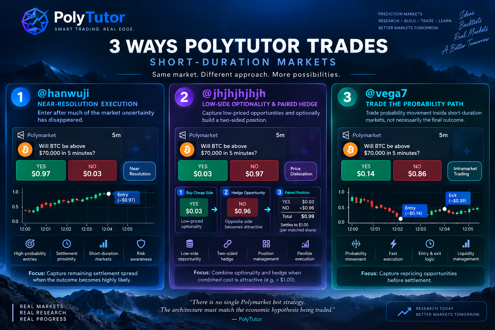

# PolyTutor Trading Systems

**Polymarket bots, execution infrastructure and custom strategy automation.**

PolyTutor researches and builds automated systems for prediction markets, with a focus on execution, market structure, risk management and short-duration trading.

> Commercial availability is separate from research status. Some systems are available for customization, while others remain research concepts.

<p align="center">
  
</p>

| System | Status | Market |
| --- | --- | --- |
| [Short-Duration Crypto Execution System](#short-duration-crypto-execution-system) | **AVAILABLE** | BTC / ETH / SOL / XRP short-duration |
| [Paired Hedge Trading System](#paired-hedge-trading-system) | **CUSTOM BUILD** | Two-sided outcome markets |
| [Polymarket Copy Trading System](#polymarket-copy-trading-system) | **CUSTOM BUILD** | Leader-follower execution |

**AVAILABLE** means a working system exists and PolyTutor can currently discuss commercial delivery or customization. **CUSTOM BUILD** means relevant research, architecture, and implementation experience exist, and the client system is developed to their requirements. **RESEARCH** is reserved for public research that is not offered as a commercial system.

This catalog lists three flagship offerings. It is not a conversion of every Strategy Handbook page into a product. Trading software does not guarantee profit.

[Request a Bot](https://github.com/polytutor-labs-handbook/polymarket-trading-bots/issues/new?template=bot-request.yml) · [View Trading Evidence](../case-studies/trading-accounts/README.md) · [Custom Development](./custom-development.md)

---

## Short-Duration Crypto Execution System

| | |
| --- | --- |
| **Status** | AVAILABLE |
| **Market** | BTC, ETH, SOL, and XRP short-duration Up/Down markets (5-minute, 15-minute, and hourly windows, depending on scope) |
| **Category** | Execution / short-duration crypto |

### What It Does

An execution-focused system for short-duration crypto prediction markets: discovering markets, tracking remaining time and book state, sending orders, and managing positions through the window. Direction is only one input. Fill quality, timing, and leftover exposure decide whether a signal is still a trade.

Research and engineering are informed by real-market activity. Owner-controlled accounts are not proof that this system produced every observed trade.

### Core Capabilities

- Market discovery and window tracking
- Market-state and time-remaining checks
- External/reference data where the client specification requires it
- Order execution and fill handling
- Position management through settlement or early exit
- Risk limits and logging

### Evidence

Research and engineering informed by real-market activity:

- [Trading Evidence](../case-studies/trading-accounts/README.md)
- [@hanwuji — near-resolution research](../case-studies/trading-accounts/hanwuji-near-resolution.md) · [ownership evidence](../case-studies/trading-accounts/ownership-evidence.md#hanwuji)
- [@vega7 — intramarket repricing research](../case-studies/trading-accounts/vega7-intramarket-repricing.md) · [ownership evidence](../case-studies/trading-accounts/ownership-evidence.md#vega7)
- [BTC 5-Minute Markets — Direction vs Execution](../case-studies/btc-5m-execution.md)
- [Crypto Short-Duration Research](../bots/crypto-short-duration.md)
- [Last-Seconds Research](../bots/last-seconds.md)
- [Architecture](../engineering/architecture.md)

### Customization

Clients can change market set, window length, entry and exit policy, position sizing, risk limits, logging, and deployment. Exact thresholds and private signal formulas stay out of this public catalog.

### Delivery

Depending on the project agreement:

- source-code delivery
- client VPS deployment
- custom integration
- maintenance

### Risks

Short windows leave little time to recover from a late fill, a stale book, or a last-window reversal. Liquidity can disappear. Simulation is not live execution. Historical account activity is not future performance.

### Interested in this system?

[Request a Bot →](https://github.com/polytutor-labs-handbook/polymarket-trading-bots/issues/new?template=bot-request.yml)

[Contact PolyTutor →](../docs/contact.md)

---

## Paired Hedge Trading System

| | |
| --- | --- |
| **Status** | CUSTOM BUILD |
| **Market** | Binary and complementary-outcome Polymarket markets |
| **Category** | Two-leg hedging / combined-cost construction |

### What It Does

A client-specific system for first-leg entry, opposite-side monitoring, combined-cost checks, and hedge execution only on matched quantity. Unmatched size remains directional. A second leg may never become available.

This is not guaranteed arbitrage.

### Core Capabilities

- Two-sided outcome tracking
- Combined-cost calculation
- Matched versus unmatched quantity
- Hedge execution and cancellation
- Partial-fill handling
- Position reconciliation

### Evidence

Research and engineering informed by real-market activity:

- [@jhjhjhjhjh — low-side optionality and paired hedge](../case-studies/trading-accounts/jhjhjhjhjh-low-side-hedge.md) · [ownership evidence](../case-studies/trading-accounts/ownership-evidence.md#jhjhjhjhjh)
- [Trading Evidence](../case-studies/trading-accounts/README.md)
- [Dual-Price Research](../bots/dual-price-reversion.md)
- [Price Dislocation](../bots/price-dislocation.md)
- [Dump & Hedge Research](../bots/dump-hedge.md) (attributed concept)
- [Architecture](../engineering/architecture.md)

Owner-controlled account activity does not prove that every cheap-side or two-sided position came from one bot.

### Customization

Clients can define first-leg filters, hedge triggers, combined-cost limits, size matching rules, cancellation policy, and risk caps. Quantity-matching and second-leg failure handling are specified per project.

### Delivery

- custom build from a written specification
- source-code delivery when agreed
- client VPS deployment when operations are in scope
- maintenance depending on agreement

### Risks

The hedge can fail, arrive late, or fill at a worse combined cost. Fees and slippage can remove a paper gap. Unmatched inventory is directional risk. Combined cost can move above $1 before the second fill.

### Interested in this system?

[Request a Bot →](https://github.com/polytutor-labs-handbook/polymarket-trading-bots/issues/new?template=bot-request.yml)

[Contact PolyTutor →](../docs/contact.md)

---

## Polymarket Copy Trading System

| | |
| --- | --- |
| **Status** | CUSTOM BUILD |
| **Market** | Client-selected Polymarket markets |
| **Category** | Leader-follower execution |

### What It Does

A follower system that detects eligible leader activity and translates it into independently risk-controlled orders. A leader fill is not a follower fill. Detection delay, a later book, and missing liquidity can change the economics.

Leader wallets, private sizing rules, and client account details are not published here.

### Core Capabilities

- Leader activity detection
- Outcome matching
- Follower execution
- Position translation
- Sizing and exposure controls
- Duplicate-trade prevention
- Risk validation

### Evidence

- [Copy Trading research](../bots/copy-trading.md)
- [Architecture](../engineering/architecture.md)
- Handbook: [Leader-Follower Copy Trading](https://github.com/PolyTutor-Labs/polymarket-strategy-handbook/blob/main/strategies/copy-trading/leader-follower-copy-trading.md)

This offering is a custom build. Public research and implementation experience are not a ready-made copy-trading product and not a claim that any named leader is followed.

### Customization

Clients specify leader-selection policy, eligible markets, follower sizing, buy/sell handling, stale-signal rules, and kill-switch behavior. Wallet credentials are configured only through an agreed secure process.

### Delivery

- custom build from a written specification
- source-code delivery when agreed
- client VPS deployment when operations are in scope
- maintenance depending on agreement

### Risks

Copying another account can import adverse selection, delayed fills, and positions the follower cannot exit. Allowance, duplicate orders, and wallet safety require project-specific controls. PolyTutor does not accept trading deposits or manage client wallets through this repository.

### Interested in this system?

[Request a Bot →](https://github.com/polytutor-labs-handbook/polymarket-trading-bots/issues/new?template=bot-request.yml)

[Contact PolyTutor →](../docs/contact.md)

---

## Why PolyTutor?

Real accounts. Documented research. Engineering-focused development.

- Strategy research in the [Strategy Handbook](https://github.com/PolyTutor-Labs/polymarket-strategy-handbook)
- Real-market participation documented in [Trading Evidence](../case-studies/trading-accounts/README.md)
- Owner-controlled Polymarket accounts with [ownership demonstrations](../case-studies/trading-accounts/ownership-evidence.md)
- Execution-focused engineering
- Risk-aware architecture
- Simulation and revalidation mindset
- Custom development for client specifications

This is not a catalog of guaranteed profitable bots.

---

## How a Project Works

```text
Choose a System
      ↓
Discuss Requirements
      ↓
Define Scope
      ↓
Technical Review
      ↓
Development / Customization
      ↓
Simulation & Testing
      ↓
Delivery / Deployment
```

Not every project reaches live deployment.

---

## Start a Project

Have a Polymarket strategy you want to automate or an existing bot you want to improve?

- [Request a Bot](https://github.com/polytutor-labs-handbook/polymarket-trading-bots/issues/new?template=bot-request.yml)
- [Explore Trading Systems](./README.md)
- [View Trading Evidence](../case-studies/trading-accounts/README.md)
- [Contact PolyTutor](../docs/contact.md)
- [Read Strategy Research](https://github.com/PolyTutor-Labs/polymarket-strategy-handbook)

Need something outside these three families? See [Custom Polymarket Bot Development](./custom-development.md).

Product descriptions do not grant rights to private source code or proprietary strategy/execution logic. Delivery and licensing terms depend on the project agreement. See [Intellectual Property](../docs/intellectual-property.md).
